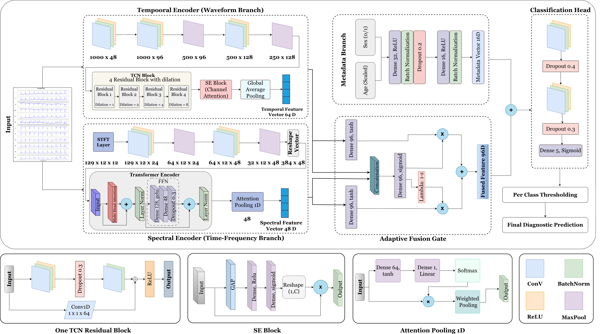

# ECG-FuseNet 🫀

**A compact, dual-domain deep learning framework for multi-label 12-lead ECG classification**

ECG-FuseNet learns from a 12-lead ECG in two complementary ways at once — how the waveform *looks over time* and how its *frequency content changes* — and fuses the two views with a learned gate. It also folds in patient age/sex, and explains its own predictions with Grad-CAM. Despite combining three sources of information, the full model is only **~0.35M parameters**.

---

## Why this exists

A standard 12-lead ECG can reveal rhythm, conduction, chamber, and muscle abnormalities — but a single recording often carries **more than one diagnosis at once**, and different conditions show up more clearly in different "views" of the signal:

- Some patterns are easiest to spot directly in the **waveform** (morphology, beat shape, timing).
- Others are easier to see in a **time-frequency** view of the same signal.

Most prior models pick one view. ECG-FuseNet uses both, lets the model *learn how much to trust each one*, and stays small enough to train and inspect easily.

---

## How it works, end to end

The diagram below is the full architecture: a 10-second, 12-lead ECG (1000 samples × 12 leads) enters two parallel encoders, patient metadata joins in through its own small branch, everything is fused adaptively, and a 5-way sigmoid head produces the final diagnostic prediction.



### 1. Temporal (Waveform) Encoder
Learns morphology directly from the raw signal:
- 3 Conv1D layers (48 → 96 → 128 filters) with batch norm + ReLU, downsampling 1000 → 250 timesteps
- **4 dilated TCN residual blocks** (dilations 1, 2, 4, 8) to capture both short beat-level shape and long-range rhythm context
- A **Squeeze-and-Excitation (SE) block** reweights the 64 feature channels by importance
- Global average pooling → a **64-D temporal feature vector**

### 2. Spectral (Time-Frequency) Encoder
Learns the same signal's frequency behavior:
- **STFT** (Hann window, 256-sample frame, 64-sample hop) turns each lead into a time-frequency map — no trainable parameters here, it's pure signal processing
- Two 2D convolutional layers (24 → 48 filters) with pooling extract local time-frequency patterns
- A **Transformer encoder** (multi-head attention + feed-forward block) models relationships across time-frequency tokens
- **Attention pooling** collapses this into a **48-D spectral feature vector**

### 3. Patient Metadata Encoder
A small MLP branch (Dense 32 → Dense 16, with batch norm and dropout) turns **age and sex** into a **16-D metadata vector** — optional context, not the main signal.

### 4. Adaptive Fusion Gate
Rather than simply concatenating the temporal and spectral vectors, a **feature-wise gate** learns, per feature, how much to weight each branch:

```
gate = σ(Dense(concat(temporal, spectral)))
fused = gate ⊙ temporal_proj + (1 − gate) ⊙ spectral_proj
```

This produces a single **96-D fused ECG representation**.

### 5. Classification Head
The fused ECG representation is combined with the metadata vector and passed through dropout + dense layers to a **5-unit sigmoid output** (one per diagnostic class, since a single ECG can have multiple labels). **Per-class thresholding** (tuned on the validation set) converts probabilities into the final diagnostic prediction.

### 6. Explainability
**Grad-CAM** is applied on the temporal branch to highlight *which part of the ECG* drove each class prediction — turning the model from a black box into something a clinician-facing analysis can actually inspect.

---

## Datasets

The same architecture was trained and evaluated **separately** on three public 12-lead ECG datasets (each with its own label space):

| Dataset | Task | Train / Val / Test |
|---|---|---|
| **PTB-XL** | 5 diagnostic superclasses (CD, HYP, MI, NORM, STTC), multi-label | 17,084 / 2,146 / 2,158 |
| **Georgia (G12EC)** | 30 labels, multi-label | 8,168 / 1,021 / 1,022 |
| **CPSC2018** | 9 labels, multi-label | 5,496 / 689 / 687 |

## Results

| Dataset | Macro AUROC | Accuracy | Macro F1 |
|---|---|---|---|
| PTB-XL | 93.42% | 89.64% | 75.48% |
| Georgia | 92.43% | 94.98% | 47.42% |
| CPSC2018 | 95.97% | 96.07% | 76.67% |

On PTB-XL, **NORM** was the easiest class (F1 0.877), while **HYP** was the hardest — its AUROC stayed above 0.91, but its F1 dropped to 0.59, showing the model ranks HYP cases well but struggles to convert that into confident positive calls, largely due to class imbalance.

### What the ablation study found
- The **temporal branch is the strongest single source of signal** (93.04% AUROC alone vs. 88.45% for spectral alone) — consistent with the learned fusion gate, which allocates roughly **71% of its weight to temporal features** across all classes.
- **Patient metadata helps, but its effect depends on what it's paired with** — it isn't a guaranteed improvement in every configuration.
- The **full architecture still wins overall**, with the highest AUROC (93.42%) and accuracy (89.64%) among every tested variant — no single module explains the result on its own.

### Model size
At **~0.35M parameters**, ECG-FuseNet is roughly **50–70× smaller** than comparable multi-representation ECG models (e.g., WResHDual-ViT at 17.98M, MS-LTCAF at 24.58M), while remaining competitive in AUROC.

---

## Key takeaways

1. **Two views beat one** — combining waveform and time-frequency representations gives a fuller picture of the ECG than either alone.
2. **Learned fusion > fixed fusion** — letting the model decide how much to trust each branch, per feature, works better than treating them equally.
3. **Small can still be strong** — a sub-half-million-parameter model reaches macro AUROC above 92% on three different public datasets.
4. **Performance ≠ interpretability by default** — Grad-CAM and gate analysis were added deliberately so the model's decisions can be inspected, not just trusted.

---

## Limitations & future work

- Class imbalance still hurts F1 for minority classes (notably HYP) even where AUROC is high.
- Georgia and CPSC2018 use different label spaces and were trained independently, so cross-dataset results reflect *architectural robustness*, not strict external validation.
- Age/sex effects haven't been studied via subgroup analysis yet.
- Inference time, memory footprint, and hardware latency are not yet benchmarked.

Planned next steps: repeated-run statistical validation, calibration analysis, harmonized external validation, subgroup evaluation, and direct compute-cost measurements.
